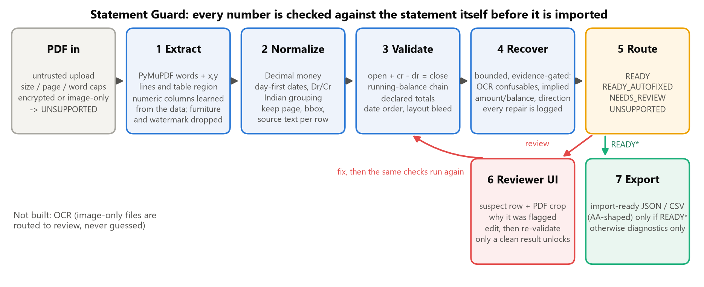
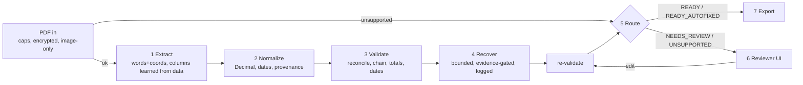

# Architecture

## Modules

| File | Job |
|---|---|
| `statement_guard/money.py` | Exact `Decimal` money, Indian/Western digit-grouping check, Dr/Cr suffix, OCR-confusable repair, day-first dates |
| `statement_guard/models.py` | Pydantic: `Txn` (with page, bbox, raw tokens, source text), `Flag`, `Repair`, `Statement`, `Status` |
| `statement_guard/extract.py` | Word/line geometry; **robust extractor**; header lexicon; summary-box reader. Also holds the disclosed "naive" first draft |
| `statement_guard/baseline.py` | The straightforward baseline used in the benchmark |
| `statement_guard/validate.py` | Document- and row-level checks; sets the status |
| `statement_guard/recover.py` | Bounded repairs; each needs independent evidence and is logged in `Statement.repairs` |
| `statement_guard/review.py` | Apply a human's edits and re-run the *same* validation |
| `statement_guard/pipeline.py`, `cli.py`, `export.py` | Orchestration, CLI, JSON/CSV/AA-shaped export |
| `bench/` | Seeded generator, scoring, three-arm evaluation, injection benchmark, lock, report, charts |
| `app/streamlit_app.py` | Demo and review UI |

## Which checks need what

| Check | Needs | Catches | Can still miss |
|---|---|---|---|
| opening + credits − debits = closing | opening and closing balance | any single amount, direction, dropped or duplicated row | two errors that cancel |
| running-balance chain | a balance column | all of the above, plus offsetting pairs; **localises the row** | an error that keeps every printed balance consistent |
| declared totals | totals printed on the statement | per-direction sums | cancelling errors within a direction |
| date order, missing fields, page-footer text inside a description | nothing | structural misreads | a wrong date that stays in order; a wrong description |
| anchor required | opening and closing found | statements we cannot anchor are never "ready" | costs false alarms (layout H) |

## Recovery rules (why it is not "guessing")

A repair is applied only when **both** hold: (1) the token was unreadable or the document is already shown to be OCR-damaged;
(2) an independent relationship in the document confirms exactly one candidate (balance chain on both sides of the row, or document
totals when there is no balance column). On a clean text layer a printed amount that disagrees with the printed balances is **not**
overridden: that is a source defect and goes to a human. Every repair is listed with its evidence and the status becomes
`READY_AUTOFIXED`, not `READY`.

## Design trade-offs

- **Strict anchoring vs. review load.** Requiring opening+closing means statements without them always need a human. Chosen because
  an unanchored first row cannot be verified.
- **No OCR.** Reproducibility and an honest failure mode over coverage; image-only files return `UNSUPPORTED`.
- **Pure geometry, no model.** Everything is deterministic and explainable in Q&A. An LLM/constrained-model fallback was considered and
  not built: it could not be benchmarked reproducibly without API keys, and the brief's question is about *catching* errors.
- **Evidence-gated repair vs. recall.** Repairs are conservative: some fixable documents go to review instead.
